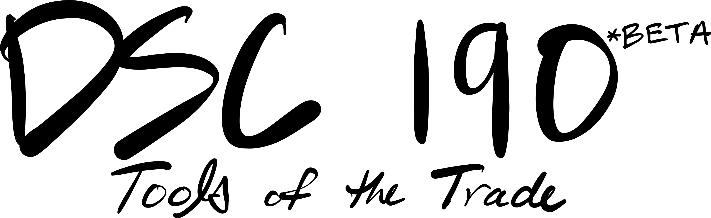
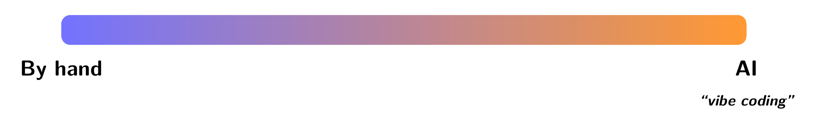
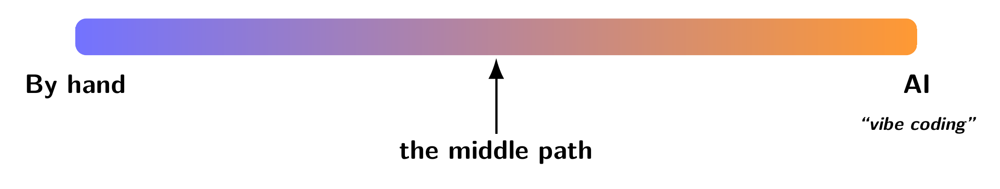
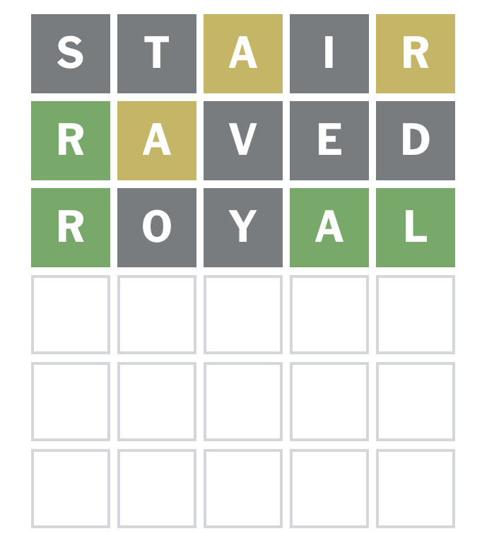

---
theme:
  path: ../../.presenterm/theme.yaml
  override:
    footer:
      style: template
      right: "{current_slide} / {total_slides}"
options:
  list_item_newlines: 2
---


Wordle
======

To follow along, clone the course repo:

```bash
git clone https://github.com/dsc-courses/dsc190-tools-2026-fa.git
```

---

<!-- new_lines: 4 -->
<!-- alignment: center -->



**<span class="term">Coding in 2026</span>**

Coding in 2026
==============

<!-- new_lines: 4 -->
<!-- alignment: center -->




Coding in 2026
==============

<!-- new_lines: 4 -->
<!-- alignment: center -->




The Problem with Vibe Coding
============================

- Vibe coding is great for one-off scripts and utilities.
- But it can lead to a "house of cards".

Claim
=====

- Claim: coding agents are great at coding, bad at *architecting* and figuring out real-world constraints.
    - Problem: most examples we can do in a single lecture won't require much of either.
    - Hard to demonstrate cases where the coding agents struggle.
- Nevertheless, vibe coding has limits, and for non-trivial problems a more structured approach is needed.


The Middle Path
===============

- You define the architecture of your software and specify what the output should be.
- The coding agent fills in the details.

Declarative Coding
==================

- In the 1970s, computer scientists explored the idea of <span class="term">**declarative programming**</span>.
    - "Standard" programming: write code that describes **how** to achieve a result.
    - Declarative programming: write code that describes **what** the result should be. Computer figures out how to achieve it.
- *Prolog* is a famous example of a declarative programming language.
    - SQL is another.
- But these were always niche languages with limited capabilities.

Declarative Coding in 2026
==========================

- Using coding agents, we can now do something like declarative programming in mainstream languages like Python.
    1. Write function signatures that specify the inputs and outputs.
    2. Write tests that describe what the functions should do.
    3. Let AI fill in the implementation details.


---

<!-- new_lines: 4 -->
<!-- alignment: center -->


**<span class="term">Demo Project: Wordle</span>**

What is Wordle?
===============



Goal
====

An app that lets us:

1) Play Wordle
    - Maybe with longer words.
2) Cheat at Wordle
    - Given a guess and the feedback, tell us which words are still possible.

Demo
====

- We'll "live code" this using a coding agent.
- **Disclaimer**: this task is **easy** -- it can be vibecoded with Claude, etc.
    - Catch-22: any task that is non-trivial for a coding agent would be too complex to demo in a single lecture.
- Nevertheless, we'll see how to do it using the "middle path".

Getting Started
===============

- The behavior of a coding agent is typically configured via `AGENTS.md` (or `CLAUDE.md` for Claude).
- Here, tell the agent how to run tests, whether to use a virtual environment, etc.
- Written in natural language.

The Middle Path
===============

- Wordle consists of a few core rules:
    1. Letters in the correct position are marked green.
    2. Letters in the word but in the wrong position are marked yellow.
    3. ...
- We will tell the agent these rules by writing tests.
- The agent will then write the code that checks these rules.


Rules of Wordle
===============

1. Letters in the correct position are marked green.


Rules of Wordle
===============

2. Letters in the word but in the wrong position are marked yellow.


Rules of Wordle
===============

- What about a guess of "APPLE" when the word is "ELOPE"?
    - Is the first "P" yellow or gray?
    - What about the second "P"?
<!-- pause -->
- It turns out that only the first "P" is yellow, and the second "P" is gray.

Rules of Wordle
===============

- What about a guess of "APPLE" when the word is "RAPID"?
    - Is the first "P" yellow or gray?
<!-- pause -->
- It turns out that the first "P" is gray, and the second "P" is green.

Writing the Tests
=================

- We will write tests that precisely capture the rules of Wordle.
- The agent will come up with a function that passes the tests.
- To write the tests, we need to know the signature of that function.
    - We can decide this ourselves, or we can ask the agent to come up with a signature.


Demo
====

- Code up the Wordle core with an agent.
    - Decide on a core function signature.
    - Write tests.
    - Have the agent implement the function.

Beyond the Core
===============

- It's most important to define the core rules using tests.
- Once that is done, we can add additional features.
    - With or without writing tests.


Demo
====

- Build a command line interface:
    - "wordle play" plays the game.
    - "wordle cheat" tells us which words are still possible given a guess and the feedback.

Demo
====

- If there's time, turn it into a web app and deploy it to GitHub Pages.
- Bonus:
    - Allow for longer words.
    - Allow for different themed word lists (e.g., San Diego).
    - ???
