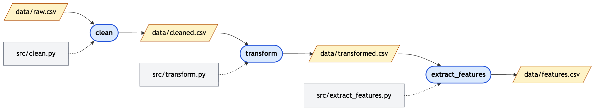

---
theme:
  path: ../../.presenterm/theme.yaml
  override:
    footer:
      style: template
      right: "{current_slide} / {total_slides}"
options:
  list_item_newlines: 2
---


Data Version Control
====================

To follow along, clone the course repo:

```bash
git clone https://github.com/dsc-courses/dsc190-tools-2026-fa.git
```

---

<!-- new_lines: 4 -->
<!-- alignment: center -->


**<span class="term">Data Version Control</span>**

Git
===

- We use git to track changes to our code.
- But git is *not* well-suited for tracking changes to large files.
    - E.g., data sets, model weights, etc.
- Problem: Git stores the entire file each time it changes.
- Repo can get very large, slow.


More Accurately...
==================

- Git *does* try to compress files and store only differences.
- But this does not work well for binary files (e.g., image data sets, PyTorch
  model weights, etc.).

Experiment: Large Files in Git
==============================

- Let's test this on some real data: the UTKFace dataset.
- Download it with:

```bash
wget https://f000.backblazeb2.com/file/jeldridge-data/015-utkfaces/utkcropped.npz
```

The UTKFace Data
================

- 9,780 cropped face images, each 200 × 200 grayscale pixels (`uint8`, 0–255).
- Stored as one NumPy array named `faces`, with shape `(9780, 40000)`.
- 267 MB compressed (as downloaded), 391 MB uncompressed.


Experiment: Large Files in Git
==============================

- Copy `demos/01-modify-data` somewhere outside the course repo, `git init` it, and download `utkcropped.npz` into it.
- `modify.py` changes 100 random pixels (out of 391 million) and saves the file:
- Commit the data, then repeat several times: modify, commit.
- After each commit, check how big the repository is.


Today: DVC
==========

- DVC (Data Version Control) is a Git extension that allows us to track large files efficiently.
- We'll see: using it is very similar to using git, but it stores large files
outside of the git repo.

Scenario
========

- You're given a dataset to analyze.
- You write a first version of your analysis code.
- You are then given an updated version of the dataset.
- You write a second version of your analysis code.
- You want to be able to track which version of the code corresponds to which
  version of the dataset.


Installing DVC
==============

- DVC can be installed into a `uv` project with:

```bash
uv add --dev dvc
```

Getting Started
===============

- To get started with dvc, while in a git repo, run:

```bash
dvc init
```

- Three things will be created:
    - `.dvc/` directory: contains dvc configuration and metadata.
    - `.dvcignore`: similar to .gitignore, specifies files to ignore for dvc.
    - `.dvc/config`: dvc configuration file.
- Commit these all to git.

Adding a File
=============

- We've received the first version of our data: utkcropped.npz
- Download it with:

```bash
wget https://f000.backblazeb2.com/file/jeldridge-data/015-utkfaces/utkcropped.npz
```

Tracking the File
=================

- To track it with dvc, run:

```bash
dvc add utkcropped.npz
```

What happened?
==============

- *dvc add* did two things:
    - Created a *placeholder* text file named `utkcropped.npz.dvc` that contains only metadata about the file.
    - Added `utkcropped.npz` to `.gitignore` so that git ignores it.
- You should commit both the placeholder file and the .gitignore to git.

utkcropped.npz.dvc
==================

```
outs:
- md5: 1aa8f7edfe3950874a2c9e220dee8495
  size: 52188308
  hash: md5
  path: utkcropped.npz
```

Placeholders
============

- DVC replaces the actual file with a metadata text file.
- The metadata is tracked with git.
- The actual file is not tracked with git, and is stored in a separate location.

Local vs. Remote
================

- The versions of your file are *still* stored in your local <span class="term">**cache**</span>.
    - Located in `.dvc/cache/`.
- This doesn't help us much:
    - We want to share the data with others.
    - We want to keep disk usage low.

DVC Remotes
===========

- DVC can store the data using many different storage providers (e.g., Google Drive, Amazon S3, a local folder, etc.).
- These are called "remotes" in DVC.
- We'll store our data using SSH to a remote server.

See: https://doc.dvc.org/user-guide/data-management/remote-storage

Adding an SSH Remote
====================

To add an SSH remote, run:

```bash
dvc remote add --default <name> ssh://<username>@<hostname>:/path/to/remote/storage
```

Commit changes of config file to git.

Pushing Data
============

To push the data to the remote storage, run:

```bash
dvc push
```

Scenario
========

- Now create, edit, and commit a code file.

Updating Data
=============

- Now we receive an updated version of the data.
- To update the data, copy it to the same location and run:

```bash
dvc add utkcropped.npz
```
- Then commit all changes with `git`.

Pushing Updated Data
====================

- To push the updated data to the remote storage, run:

```bash
dvc push
```

Notes
=====

- There is no `dvc commit`; *dvc* just writes metadata files, and you commit
  those with git.
- `dvc push` does *not* do a git push; you need to do that separately.


Scenario
========

- Your co-worker clones the repo.
- After the clone, they only have the placeholders -- not the data.

Pulling Data
============

To pull data (download it from the remote):

```bash
dvc pull
```

Going Back in Time
==================

- We can switch to a previous git commit with "git switch"
- The DVC placeholder `<filename>.dvc` will be updated.
- But the data file itself will not be changed.
- To download the correct version of the data, run:

```bash
dvc pull
```

dvc checkout
============

- *dvc pull* downloads a copy of the currently-referenced data and places it into the project directory.
- If you have already downloaded the data, it is cached.
- You can run *dvc pull*, or (maybe faster):

```bash
dvc checkout
```


---

<!-- new_lines: 4 -->
<!-- alignment: center -->


**<span class="term">Data Pipelines</span>**

Data Pipelines
==============

- In a typical data science project, we do a lot of **data processing** before we
build our model.
- Starting from the "raw data", we:
    1. Clean it
    2. Transform it
    3. Extract features
- This is a <span class="term">**data pipeline**</span>.
    - Each step is typically performed by code.

Data Pipelines
==============

- Each change you make to a processing step results in a new version of the processed data.
- Keeping the data in sync with the code can be difficult.
- DVC provides <span class="term">**data pipelines**</span> to help with this.

Idea
====

- Store the original, raw data.
- Tell DVC how to perform each step.
- DVC will automatically run the steps in the correct order, and keep track of which version of the data corresponds to which version of the code.
- Changing an earlier processing step will automatically trigger re-running of all subsequent steps.

Defining a Pipeline
===================

- Use *dvc stage add* to define a stage of the pipeline.

```bash
dvc stage add -n <stage_name> \
    -d <dependency> \
    -o <output> \
    <command>
```

- This creates/updates `dvc.yaml` with the stage information.

Running the Pipeline
====================

- Once the pipeline is defined and all stages have been added, run it with:

```bash
dvc repro
```

Demo
====

- The `02-pipeline` demo contains sample data and code for cleaning, transforming, and feature extraction.
- Define and run a pipeline with those three stages.



Demo: Things to Try
===================

- Changing the code for one of the stages and re-running the pipeline.
- Cloning a fresh copy of the repo and pulling data.
