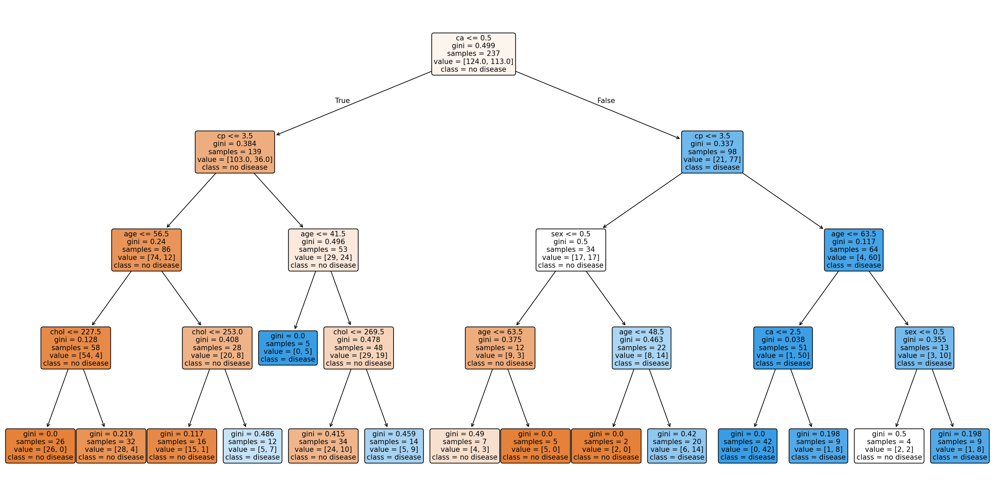

---
theme:
  path: ../../.presenterm/theme.yaml
options:
  list_item_newlines: 2
---


Deploying Applications
======================

To follow along, clone the course repo:

```bash
git clone https://github.com/dsc-courses/dsc190-tools-2026-fa.git
```

No YSK
======

- Quiz 08 (the last quiz) stops at Lecture 16.
- This lecture (and later) are not on any quiz.
- But they are useful for the final project.

---

<!-- new_lines: 4 -->
<!-- alignment: center -->


**<span class="term">Deploying Applications</span>**

Deploying
=========

- Let's say you have built a <span class="term">**data application**</span>.
    - E.g., a model, a visualization, etc.
- It runs on your machine in a Python notebook.
- How do you <span class="term">**deploy**</span> the app so that it can be used by others?

One Approach
============

- We have seen that *marimo* notebooks are easy to share.
- But often we want something more polished, easier to use.


---

<!-- new_lines: 4 -->
<!-- alignment: center -->


**<span class="term">Streamlit</span>**

Streamlit
=========

- **streamlit** is a Python library for building *web applications*.
- <span class="good">**Pro:**</span> very easy to go from Python code to a web app.
- <span class="bad">**Con:**</span> requires running a streamlit server to host the app.

Installation
============

Install with uv:

```bash
uv add streamlit
```

Streamlit
=========

- Streamlit provides functions for:
    - displaying text, images, plots, etc.
    - taking user input (e.g., text boxes, sliders, etc.)
- You define the layout of the app using Python code.
- Streamlit takes care of rendering the app in a web browser.


A First App
===========


```python
import streamlit as st

# display some text
st.title("Number Doubler")
st.write("Enter a number and I'll double it for you.")

# ask for input
number = st.number_input("Enter a number", value=0)

# this is just standard Python
doubled = number * 2

# display the result
st.write(f"{number} doubled is {doubled}.")
```

Running the App
===============

- Assume the previous was saved as "app.py".
- Run the app with:
```bash
streamlit run app.py
```

Note
====

- This starts a continually-running **server** that hosts the app.
- All of the computations are done in *Python*.
- If the server is stopped, the app will no longer work.

Demo 01
=======

- Run the app in Demo 01 and see what happens when the server is killed.
```bash
cd lectures/17-deploying/demos/01-streamlit-intro
uv run streamlit run app.py
```


Example
=======

- **Goal**: predict risk for cardiovascular disease given age, sex, chest pain type, number of blood vessels colored by fluoroscopy, cholesterol level.
- You've trained a **decision tree** model using sklearn in a notebook.
- How can you share your model with doctors so that they can predict risk for their patients?

Idea
====

- We will use *pickle* to save the model to a file, and then load the model in a streamlit app to make predictions.

Demo 02
=======

Demo 02 contains code that trains a decision tree with sklearn and *pickles* the
model to a file: model.pkl.

```bash
cd lectures/17-deploying/demos/02-heart-disease-train
uv run train.py
```

The Learned Tree
================

<!-- alignment: center -->



Demo 03
=======

Demo 03 contains code for a streamlit app that loads the pickled model and uses
it to make predictions based on user input.

First, copy over the model.pkl that Demo 02 made:

```bash
cd lectures/17-deploying/demos/03-heart-disease-app
cp ../02-heart-disease-train/model.pkl .
uv run streamlit run app.py
```

Deploying the App
=================

- Right now, this app is only running *locally*.
    - It isn't visible to others.
- To *deploy* the app, we need to host it on a streamlit server.
- There are some free options (with limitations):
    - Streamlit Community Cloud: https://streamlit.io/cloud
    - Hugging Face Spaces: https://huggingface.co/spaces

Deploying to Streamlit Community Cloud
======================================

0. Create a Streamlit Community Cloud account.
    - You can log in with your existing GitHub account.
1. Push app to a public GitHub repo.
2. Set up a new app on Streamlit Community Cloud and link it to your GitHub repo.

Limitations of Streamlit Community Cloud
=========================================

- Apps sleep after ~1 hour of inactivity; visitors must wait for restart.
- Shared CPU/memory.
- Limited number of deployed apps per workspace.

The Need for a Server
=====================

- Streamlit requires running a server to host the app.
- This costs *someone* money.
- While free options exist, they have limitations.
- Even paid options may not *scale* well.


---

<!-- new_lines: 4 -->
<!-- alignment: center -->


**<span class="term">Static Apps</span>**

Web App Architectures
=====================

- A *web app* is an application that runs in a web browser.
- Any non-trivial web app needs some way to execute code to respond to user input.
- There are two approaches:
    - **Server-side**: the code is executed on the server, and the results are sent to the client as HTML.
    - **Client-side**: the code is executed on the client's machine (in their browser) using JavaScript.

Static Apps
===========

- With streamlit, all computations are done *server-side* in Python.
    - This is a *centralized* architecture.
    - If there are 1 million users, the server must handle all 1 million requests.
- Alternatively, we could run the computations *client-side*, on the user's machine.
    - I.e., in their browser using *JavaScript*.
    - This is a *decentralized* architecture.
- Because this does not require executing code dynamically on the server,
    this is called a **static app**.
    - <span class="good">**Pro:**</span> it is much cheaper to host.
    - <span class="bad">**Con:**</span> it is not as straightforward, especially if the app is complex.

How?
====

- We trained our model using *sklearn*, a Python app.
- Don't we need sklearn to run the model?
<!-- pause -->
- No!
    - The model is just a mathematical function that takes in some numbers and
      outputs a prediction.
    - Once the model is trained, it can be implemented in any programming language, including JavaScript.


How?
====

- There exist tools for exporting sklearn models to common formats that can be used within JavaScript.
    - E.g., ONNX (Open Neural Network Exchange).
- But our model is a simple decision tree, which is easy to implement from scratch in JavaScript.
- *Especially* using coding agents.

Demo 04
=======

Using a coding agent, "port" the decision tree model from Python to a static JS
web app in demos/04-heart-disease-js (it starts empty).

Then, deploy using GitHub Pages.

Limitations
===========

- This approach requires us to "translate" the model from Python to JavaScript.
- By itself, almost any model can be implemented in JavaScript.
- But the *data preprocessing* steps may be more complex and difficult to implement in JavaScript.

---

<!-- new_lines: 4 -->
<!-- alignment: center -->


**<span class="term">Serving an API</span>**

Deploying for Machine Use
=========================

- The previous approaches have been focused on deploying apps for *human* use.
- Often, we want to deploy a model so that it can be used by other *programs*.
- One approach: give them the code/model parameters.
    - <span class="bad">**Bad:**</span> exposes implementation details, may leak
    secrets
- Another approach: create an *API*.

What is an API?
===============

- An API (Application Programming Interface) is a standard way for programs to interact with each other.
- A *web API* is an API that is accessed over the web using HTTP requests.
    - Since every programming language can make HTTP requests, allows programs written in different languages to interact.
- Example: the Pokemon API (https://pokeapi.co/).

Creating APIs in Python
=======================

- *FastAPI* is a popular Python framework for creating web APIs.
- Install with:

```bash
uv add fastapi
```

Example: A first API
====================

- Suppose we've developed a Python library for computing the area of different shapes.
- We want to make this available via an API.

Example: A first API
====================

```python
from fastapi import FastAPI

app = FastAPI()

@app.get("/circle")
def circle(radius: float):
    return {"shape": "circle", "area": 3.1415 * radius**2}


@app.get("/rectangle")
def rectangle(width: float, height: float):
    return {"shape": "rectangle", "area": width * height}


@app.get("/triangle")
def triangle(base: float, height: float):
    return {"shape": "triangle", "area": 0.5 * base * height}
```

Example: A first API
====================

- Assuming this is saved as `app.py`, run (in development mode) with:

```bash
fastapi dev app.py
```

- Run in production mode with:

```bash
fastapi run app.py
```

Demo 05
=======

Demo 05 contains the shapes API. Run it, then try it out in a browser at
http://localhost:8000/circle?radius=2 or with the docs at http://localhost:8000/docs.

```bash
cd lectures/17-deploying/demos/05-shapes-api
uv run fastapi dev app.py
```

Hosting a Model with FastAPI
============================

- We can use FastAPI to host our model as an API.
- See Demo 06. Like Demo 03, it needs the model.pkl from Demo 02:

```bash
cd lectures/17-deploying/demos/06-heart-disease-api
cp ../02-heart-disease-train/model.pkl .
uv run fastapi dev app.py
```

---

<!-- new_lines: 4 -->
<!-- alignment: center -->


**<span class="term">Deploying with Docker</span>**

Deploying with Docker
=====================

- Our FastAPI app requires a server (just like our streamlit app).
- FastAPI provides a similar service to Streamlit Community Cloud.
    - fastapicloud.com
- Instead, let's deploy to a cloud provider by providing a Docker image.

Deploying with Docker
=====================

- Many cloud providers will host Docker images.
    - AWS, Google Cloud, Azure, Fly.io, etc.
- A *very* general approach.
    - Works for any language, framework, etc.
- We will start by building a Docker image for our FastAPI app.

Demo 07
=======

Demo 07 contains a Dockerfile for our FastAPI app. Build the image and run it
locally.

```bash
cd lectures/17-deploying/demos/07-heart-disease-docker
cp ../02-heart-disease-train/model.pkl .
docker build -t heart-disease-api .
docker run -p 8000:8000 heart-disease-api
```

Deploying
=========

- We will deploy to Hugging Face Spaces.
- The process:
0. Register your public SSH key.
1. Create a new space and clone it.
2. Add a Dockerfile that builds your FastAPI app.
3. Push to Hugging Face.

Demo
====

Publish the app to Hugging Face Spaces.

Deciding: Server Side or Client Side? 
======================================

- Default to deploying client-side.
- When do we prefer server-side code execution?
    - When the code is secret/proprietary.
    - When the computational resources are large.
    - When the app involves many complex pieces that would be difficult to implement in JavaScript.
        - e.g., a database, user authentication, etc.
- This example: maybe should have been implemented in JS (client-side).
